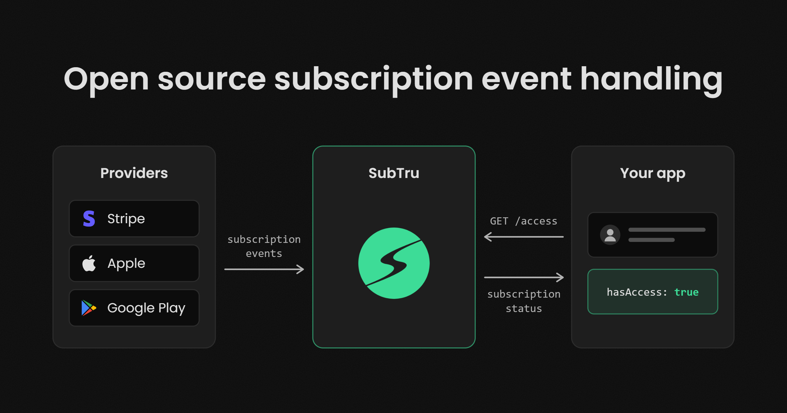

# SubTru

Open source infrastructure for managing your users’ subscriptions.

The SubTru API processes subscription events sent from Stripe, the Apple App Store, and Google Play, maintains your users' subscriptions in a PostgreSQL database, and provides an endpoint your app can use to fetch any user's subscription status.

- [SubTru API Repo](https://github.com/subtru/subtru)
- [SubTru Website](https://subtru.com)
